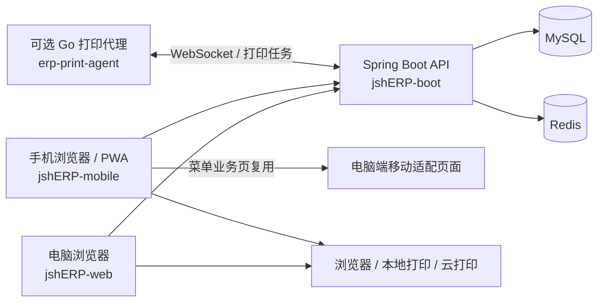

# 项目全景、代码复用与业务闭环建议

> 梳理日期：2026-11-15  
> 范围：`jshERP-web`、`jshERP-mobile`、`jshERP-boot`、`erp-print-agent`、部署与项目文档。  
> 说明：这是基于仓库结构、交接文档及代表性单据服务的静态梳理。业务建议中的“核对/补齐”不代表当前功能一定缺失；应先对照产品规则、数据库和实际页面确认。

## 1. 项目定位与整体结构

项目当前由电脑端 Web、手机 Web/PWA、Java ERP 后端、可选 Go 打印代理和部署环境组成。手机端不是独立原生 App；业务数据统一由后端访问 MySQL，Redis 用于缓存/会话等运行能力。



| 目录 | 职责 | 当前特点 |
|---|---|---|
| `jshERP-web/` | Vue 2 + Ant Design Vue 电脑端与移动适配业务页 | 主前端工程；路由页面按业务域组织；共享大量 Jeecg 风格组件、mixins 和工具 |
| `jshERP-mobile/` | 手机登录、菜单、个人中心、PWA 外壳 | 复用 Web 端依赖和构建工具；业务菜单大多在 iframe 中复用 Web 页面；输出到 `jshERP-web/dist/mobile` |
| `jshERP-boot/` | Spring Boot 2 / Java 8 后端、API、数据访问和静态资源托管 | 约 39 个 controller、38 个 service；`datasource` 下含 entities、mappers、vo |
| `erp-print-agent/` | 可选的 Go 打印代理 | 独立配置、协议、设备队列和 WebSocket 客户端；通过协议与 ERP 解耦 |
| `deploy/`、`tools/`、根部署脚本 | 本地、远程、容器化和打印端部署 | 入口较多，需要明确唯一推荐路径与脚本适用环境 |
| `docs/` | 开发交接、打印代理、部署和专项记录 | 现有交接资料细，但有些项目说明仍引用旧工具/版本，应建立统一入口与更新责任 |

## 2. 业务域地图

| 业务域 | 前端位置 | 后端主要入口 | 主要业务对象/联动 |
|---|---|---|---|
| 基础资料 | `views/material`、`views/system` | `Material*`、`SupplierController`、`PersonController`、`DepotController`、`AccountController` | 商品、SKU/扩展属性、分类、客户/供应商、人员、仓库、账户、组织、字典、权限 |
| 采购 | `views/bill`（采购申请、采购订单、采购入库、采购退货） | `DepotHeadController`、`DepotItemController` | 单据主从表、来源单、收货数量、库存增加、供应商应付/预付款 |
| 销售与零售 | `views/bill`（销售订单、零售销售、销售出库、销售退货） | `DepotHeadController`、`DepotItemController` | 销售数量、出库、客户应收、会员预收款、退货回滚 |
| 仓储 | `views/bill`、`views/material`、`views/report` | `DepotHeadController`、`DepotItemController`、`SerialNumberController` | 其他出入库、调拨、组装/拆卸、盘点、库存查询、批次/序列号、库存预警 |
| 财务 | `views/financial`、部分 `views/report` | `AccountHeadController`、`AccountItemController`、`AccountController` | 收付款、收入支出、转账、预收预付、往来余额、财务单据审核 |
| 报表与仪表盘 | `views/report`、`views/dashboard` | 复用各领域查询 API | 采购销售统计、库存、应收应付、收支和经营概览 |
| 系统与租户 | `views/system`、`views/user` | `UserController`、`RoleController`、`TenantController`、`FunctionController`、`SystemConfigController` | 登录、用户/角色/菜单权限、租户、配置、日志、消息、表格元数据 |
| OCR / AI | `views/system/AddressRecognize.vue`、配置页 | `OcrController`、`AiConfigController` | 地址/个人信息识别、可配置服务调用、人工校正后写入业务数据 |
| 打印 | `views/material/utils`、`views/print`、`views/bill/dialog` | `PrintController`、`PrintTemplateController`、`LabelProviderController`、`SequenceController` | 单据打印、标签模板、标签数据源、浏览器/本地/网络/代理打印 |

## 3. 当前可复用能力

### 前端

- **列表与表单基础设施**：`components/table`、`components/DataTable*`、Jeecg 公共组件及 `mixins/JeecgListMixin.js`。新增标准 CRUD 页面前先检查现有列表查询、分页、权限按钮和弹窗表单模式。
- **请求与登录态**：`src/utils/request.js`、`src/api/`、用户/权限 Vuex 模块。API 访问、token 附加、登录过期处理不应在页面里另写一套。
- **移动端公共交互**：`components/mobile/`、`mobilePageHeader`、`scrollBlank`、页面布局工具。注意全局状态/事件在卸载时必须清理。
- **商品展示与选择**：`views/material/utils/materialDisplay.js`、商品选择组件和商品字段配置。价格、条码、SKU、单位换算等展示口径应复用同一解析结果。
- **打印模板链路**：V2 模板结构、模板 Store/Provider、数据解析、标签布局与打印工具。模板解析和格式迁移不应在业务页重复实现。
- **通用打印适配**：`printerSearch.js`、`localPrintAgent.js`、`api/printAgent.js` 与后端代理协议。浏览器能力探测和打印失败反馈应沿用统一适配层。
- **手机 Web/PWA 外壳**：`jshERP-mobile/src` 管导航、认证和入口；电脑端页面继续负责当前已适配的业务。跨端共享优先统一 API 契约和业务规则，不要为了“复用”把所有 UI 堆进一个巨型组件。

### 后端

- `controller -> service -> datasource/mappers` 是主要调用链。业务校验、库存/往来账联动和事务应在 service 层，不要由 controller 拼装业务副作用。
- 单据服务已有事务与审核状态逻辑，例如 `DepotHeadService`、`AccountHeadService`；新流程优先复用单据号、来源单关联、日志和审核口径。
- `BaseController`、统一响应工具、异常类和常量可用于保持现有 API 风格；新增接口应减少直接返回裸字符串/多种响应形态的情况。
- 打印代理有独立协议及配对交接文档；ERP 与代理通过消息协议交互，不应把设备厂商细节混进销售/库存服务。

## 4. 优先级优化建议

### P0：发布与凭据安全

1. 统一部署入口，明确每个脚本支持的主机、容器和构建模式；避免 PowerShell、Shell、通用部署脚本长期各自演进。
2. Shell 部署脚本存在密码默认值，并关闭 SSH 主机密钥校验。若用于真实主机，应改为 SSH key/外部 secret 注入、强制校验 host key，并移除密码默认值；确认旧凭据是否实际使用过，再按需要轮换。
3. 忽略文件中的本地令牌/密码继续保持不入库；发布时禁止把 `.env`、密钥、证书私钥或生产数据打进前端包、JAR 或日志。

### P1：明确关键业务不变量

1. 建立单据状态表：草稿、待审、已审、部分完成、完成、关闭/作废等状态由哪些操作迁移；每种迁移检查什么前置条件、产生什么副作用。
2. 库存变更使用可追溯的库存流水。审核入库/出库/调拨/盘点时原子更新流水和单据；反审核按原流水做反向冲销；已审核单据不直接物理删除。
3. 对采购/销售来源单维护数量闭环：原数量、已下游数量、剩余数量、强制关闭数量；重复提交、并发审核和部分收发均要避免超收/超发。
4. 往来账与收付款建立明确分摊：一笔收/付款可关联多个单据，支持部分结清、预收/预付抵扣、退款/冲销和余额重算；规定舍入精度与币种口径。
5. 关键写操作需要幂等保护和并发约束：单号生成、重复提交、重复回调、审核与反审核不应造成重复扣库存/重复记账。
6. 明确租户隔离和数据权限边界：每个读写查询都核对 tenant、组织、用户仓库范围；前端隐藏按钮只作体验控制，后端必须再次授权。

### P1：建立自动化回归基线

目前后端仅看到测试资源配置，没有明显的业务测试目录；建议优先补业务服务测试和 API 冒烟测试，而非先追求全量 UI 自动化。最低覆盖：审核/反审核、库存不足、部分收货/发货、关联单据关闭、往来余额、权限越权、重复提交。

### P2：拆小高耦合服务和页面

1. `DepotHeadService` / `DepotItemService` 承担多种单据与库存口径，后续可按“单据生命周期、库存流水/可用量、数量汇总、往来账联动”拆小协作者；先补特征测试再移动逻辑，避免大爆炸重构。
2. 前端 `views/bill` 中复杂单据页面应把“字段定义/校验、行项目编辑、汇总计算、提交映射”拆为可复用模块，页面容器负责流程编排。
3. 保持业务域边界：采购/销售/库存/财务的规则由领域 service 决定；共享组件只放纯 UI 或纯转换，避免 `utils` 变成没有归属的业务逻辑仓库。
4. 逐步统一 API 响应、错误码、日期/金额/数量格式和分页参数；先对新接口定标准，再兼容迁移旧接口。

### P2：文档、构建与版本治理

1. 以本文件作为项目导航入口，链接已有开发约定、手机 Web/PWA 说明、打印代理配对说明和部署数据说明，不复制那些专项手册。
2. 更新根 README 和 `jshERP-web/README.md` 中与当前 npm 脚本、Node/Maven 版本、部署方式不符的说明。
3. 给部署脚本增加构建产物来源/版本号/提交号输出，健康检查覆盖 API、静态入口、手机入口和关键配置读取；回滚记录前后端配套版本。
4. 前后端配置按开发/测试/生产环境分层，避免使用同一份默认地址或硬编码服务凭据。

## 5. 业务逻辑补充与核对清单

以下是业务闭环建议，实际落地前要由业务方确认：

### 采购闭环

```text
采购申请（可选）→ 采购订单 → 采购入库（可分批）→ 供应商应付/付款 → 对账/结清
                                      ↘ 采购退货 → 库存冲减/应付冲销
```

- 订单行跟踪已入库量和未入库量；允许部分入库，支持短收、拒收、补收和关闭剩余数量。
- 入库审核时验证仓库、商品、单位换算、批次/序列号和重复收货；退货必须关联可退数量或记录独立原因。
- 付款可跨单据分摊，预付款可抵扣，反审核时禁止产生负库存/错误应付余额。

### 销售闭环

```text
报价/销售订单（可选）→ 销售出库/零售销售 → 客户应收/收款 → 对账/结清
                                  ↘ 销售退货 → 库存恢复/应收冲销
```

- 建议明确订单是否占用库存、可售量计算公式、超卖策略、部分发货与强制关闭规则。
- 价格、折扣、税额、运费、赠品、单位换算需统一计算顺序；保存快照以免商品价格变更影响历史单据。
- 退货验收需确认退回仓库、可二次销售/报损状态，并按原成本或产品规定成本回冲。
- 收款支持部分收款、预收款、退款及一笔多单分摊，余额在并发下保持准确。

### 库存闭环

- 统一明确“账面库存、锁定库存、可用库存、在途库存”的定义和查询口径。
- 调拨应明确采用单步原子调拨，还是调出/在途/调入两阶段；后者要处理运输差异、丢失和超时单。
- 盘点差异必须形成调整单及审核日志；批次、效期、序列号和负库存策略需要按商品/仓库配置。
- 组装/拆卸按 BOM 维护组件数量、损耗和成本分摊，并校验组件可用量。
- 月末库存成本结转、成本重算的截止时间和已结账期间锁定规则要可追溯。

### 财务闭环

- 定义应收/应付余额来自哪些审核单据，核销先后顺序、账龄起算日、逾期规则和期初余额口径。
- 收付款分录需记录账户、对方单位、来源单据、经手人和附件；反审核以冲销方式保留审计链。
- 账户余额变化、内部转账、退款、预收预付抵扣和费用归类都应由服务端同一事务处理。
- 若产品范围包含会计核算，再单独确认科目、凭证、期间关账、银行对账和利润口径；不要把经营流水报表误当完整总账。

### 横向流程

- 统一审核策略：单据创建人、审核人分离规则，审核时间/人、反审核原因、权限、日志和附件要求。
- 统一作废/删除策略：草稿可删除；已审核单据通过反审核/冲销/关闭处理，保留历史来源链。
- 统一提醒：待审核、待收货/发货、逾期应收应付、库存预警、批次临期；提醒须可配置、可关闭、可追踪。
- OCR 识别只生成待确认草稿，不直接自动记库存或财务；保存原图、字段置信度、人工修改和最终提交人的审计信息。

## 6. 建议实施顺序

1. **先做安全与发布基线**：整理 SSH 凭据、禁用不安全脚本默认、确定唯一部署流程。
2. **再定义业务状态与账务/库存不变量**：选采购入库、销售出库、收付款各一条主链路画状态图并由业务确认。
3. **补针对性测试**：给已确认的状态迁移和库存/余额副作用加服务层测试。
4. **按边界小步复用/拆分**：前端复用已存在组件，后端提取单据生命周期协作者，逐模块替换，不做无依据的大重写。
5. **最后补报表与提醒闭环**：确保每个提醒、统计和导出都复用权威业务查询口径。

## 7. 相关文档

- [开发约定与模块调用交接文档](开发约定与模块调用交接文档.md)
- [打印代理配对逻辑交接文档](打印代理配对逻辑交接文档.md)
- [手机 Web/PWA 目录说明](../jshERP-mobile/README.md)
- [项目根 README](../README.md)
